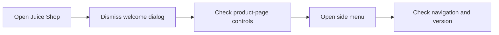

# OWASP Juice Shop — UI Smoke Tests

> A focused WebdriverIO and Cucumber smoke suite that verifies the visibility of essential marketplace controls.

## Scenario under test

The included Gherkin scenario opens an OWASP Juice Shop deployment, dismisses the welcome dialog when present, and checks:

- language selector;
- “All Products” heading;
- page-size selector;
- paginator information;
- next and previous controls;
- Contact and About Us side-menu entries;
- application version information.

## Structure

| Path | Responsibility |
|---|---|
| `features/ui.feature` | human-readable acceptance scenario |
| `features/step-definitions/steps.js` | browser actions and assertions |
| `features/pageobjects/products.page.js` | product-page selectors |
| `features/pageobjects/sideMenu.page.js` | side-menu selectors |

## Run locally

This repository includes a committed dependency tree but no root package manifest or runner configuration. For a clean setup, create a WebdriverIO Cucumber project, install the required packages, and point its `specs` and `cucumberOpts.require` settings to this repository's `features` directory.

The current scenario targets `http://juiceshop.tdlbox.com/`. Replace it with a local or otherwise authorised OWASP Juice Shop instance before running the suite.

> This project is intended for legal QA and security-training environments only.
